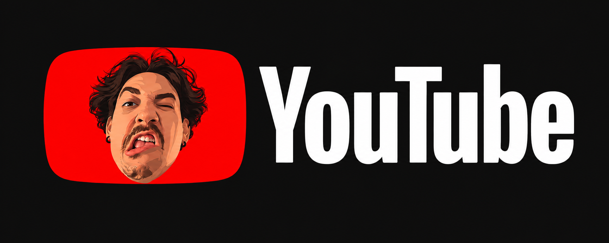

<div align="center">
  

  # SmartTube Harbor

  **A community-maintained Android TV fork of [SmartTube](https://github.com/yuliskov/SmartTube).**

  [Latest beta builds](https://github.com/GeorgeHarbor/SmartTube/releases/tag/latest) · [Upstream project](https://github.com/yuliskov/SmartTube)
</div>

## Why this fork exists

SmartTube Harbor is a personal, open-source fork for experimenting with a more polished Android TV experience and sharing those improvements as installable builds. It keeps SmartTube's core video browsing and playback, while adding focused interface refinements, faster playback startup, and better Android TV integration. The fork regularly merges changes from the upstream SmartTube project.

## What this fork adds

- **A refreshed player layout:** YouTube TV-style playback controls, clearer title and detail placement, and a cleaner controls background.
- **Branded loading screens:** A custom app startup screen and a video-opening screen with a dimmed, blurred thumbnail and slim red arc loader.
- **Faster playback startup:** Decoder reuse, less repeated JSON parsing, and playback warm-up after the first home row loads.
- **Android TV Watch Next integration:** Partially watched videos can appear in Watch Next, and selecting a row opens the video in the app.
- **Clearer settings navigation:** Icons in the settings menu and additional interface refinements.

## SmartTube features retained

SmartTube Harbor builds on SmartTube's established feature set, including SponsorBlock, playback speed controls, high-resolution and high-frame-rate playback, HDR support, live chat, customizable buttons, and operation without Google Services. See the [upstream project](https://github.com/yuliskov/SmartTube) for broader documentation and compatibility details.

## Install

Download the latest beta APK for your device from [GitHub Releases](https://github.com/GeorgeHarbor/SmartTube/releases/tag/latest). Choose the matching architecture (`arm64-v8a` for most recent TVs, `armeabi-v7a` for many older devices, or `x86` where applicable). Android TV requires sideloading; see the [upstream installation guide](https://github.com/yuliskov/SmartTube#installation) for step-by-step instructions.

> This is an independent fork. Builds and releases are provided from this repository; upstream release links and update instructions may not apply.

## Build from source

The project uses Gradle and JDK 17. Clone with submodules, then build the beta release:

```sh
git clone --recurse-submodules https://github.com/GeorgeHarbor/SmartTube.git
cd SmartTube
./gradlew assembleStbetaRelease
```

## Upstream

SmartTube Harbor is based on [SmartTube by Yurii Liskov](https://github.com/yuliskov/SmartTube), a free and open-source media client for Android TVs and TV boxes. Please see the upstream repository for its license, original contributors, and project history.
